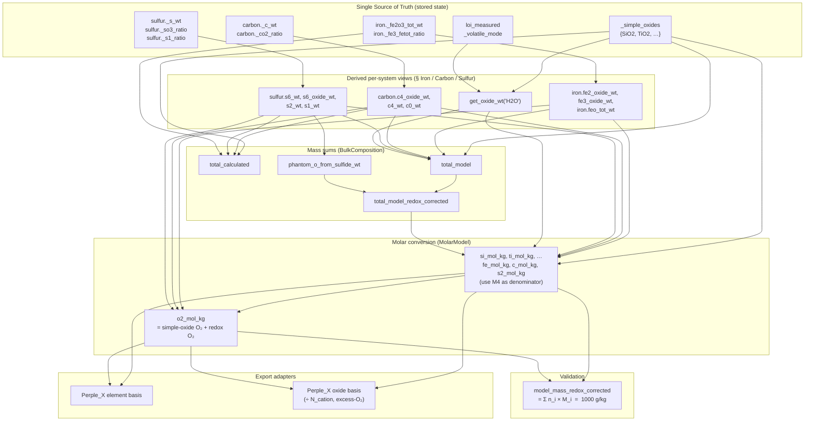

# ThermoChemX: Mathematical Documentation

This document provides a comprehensive overview of the mathematical equations, conversion
formulas, and calculation methodology used in ThermoChemX v1.0.0.

## Table of Contents

1. [Overview](#overview)
2. [Computation Flow](#computation-flow)
3. [Fundamental Constants](#fundamental-constants)
4. [Component Sets](#component-sets)
5. [Basic Conversions](#basic-conversions)
6. [Molar Model](#molar-model)
7. [Iron System](#iron-system)
8. [Carbon System](#carbon-system)
9. [Sulfur System](#sulfur-system)
10. [LOI and Volatile Modes](#loi-and-volatile-modes)
11. [Oxygen Balance](#oxygen-balance)
12. [Oxide-Basis Representation](#oxide-basis-representation)
13. [Normalization](#normalization)

---

## Overview

ThermoChemX converts bulk rock compositions from weight percent (wt%) to molar quantities
(mol/kg) suitable for thermodynamic modeling. The calculation engine implements a
**Single Source of Truth (SSoT)** pattern where each element system maintains minimal
internal state and derives all other values through mathematical relationships.

The engine is **fully lazy**: there are no batch updates, no recomputation passes, and no
cached intermediate state. Every derived quantity is implemented as a Python `@property`
that pulls its inputs on demand from the SSoT layer. When the GUI asks for
`model.si_mol_kg`, the property chain walks back to the raw oxide wt% values; the chain is
short, deterministic, and guaranteed to use the latest user input.

Two export representations are produced from the same engine state:

- **Element basis** — components are elements and diatomic molecules
  (Si, Ti, Al, …, Fe, C, S₂, H₂, O₂). Carries the full redox budget.
- **Oxide basis** — components are oxides plus S₂ and an *excess*-O₂ term
  (SiO₂, TiO₂, …, H₂O, CO₂, S₂, O₂). See [Oxide-Basis Representation](#oxide-basis-representation).

---

## Computation Flow

This section is the answer to the question "in what order does ThermoChemX compute
things?". The short answer: **there is no order in the imperative sense** — there is a
dependency graph, and each node computes itself when first asked.

### Dependency graph



### What happens on a single GUI refresh

When the user edits a spinbox, the model emits `compositionChanged`, and `refresh_ui()`
queries the properties it needs. Behind every query, the dependency graph is walked
**lazily, exactly once per top-level access**:

1. **SSoT layer** — raw wt% values are already in memory (`_simple_oxides`,
   `iron._fe2o3_tot_wt`, `iron._fe3_fetot_ratio`, `carbon._c_wt`, `carbon._co2_ratio`,
   `sulfur._s_wt`, `sulfur._so3_ratio`, `sulfur._s1_ratio`, `loi_measured`,
   `_volatile_mode`). Nothing is computed here.

2. **Per-system derived views** — when asked, each system property (e.g.
   `iron.fe2_oxide_wt`, `carbon.c0_wt`, `sulfur.s2_wt`, `get_oxide_wt('H2O')`) returns a
   value computed on the spot from its SSoT inputs.

3. **Mass sums** — `total_model` walks through the simple-oxide dict and pulls FeO,
   Fe₂O₃, CO₂(real, `c4_oxide_wt`), C⁰ (graphite, `c0_wt`), SO₃(real, `s6_oxide_wt`),
   reduced S (`s_red_wt = s1 + s2`), H₂O. Independently,
   `phantom_o_from_sulfide_wt` reads `sulfur.s2_wt` and `sulfur.s1_wt` and multiplies by
   $M_\mathrm{O}/M_\mathrm{S}$ (coefficients 1.0 and 0.5). Both feed into
   `total_model_redox_corrected`.

4. **Molar conversion** — every `*_mol_kg` property in `MolarModel` calls
   `_abs_mol(wt, M, N)` and scales by `1000 / total_model_redox_corrected`. The corrected
   denominator is therefore baked in at the very first molar division — there is no
   "uncorrected mol/kg" intermediate stage.

5. **Oxygen balance** — `o2_mol_kg` is a *consumer* of step 4: it sums already-normalised
   cation mol/kg values multiplied by their O₂ stoichiometric coefficients ($+1.0$ for
   C⁴⁺, $0$ for C⁰ graphite, $+0.5$ for Fe²⁺, $+0.75$ for Fe³⁺, $+1.5$ for S⁶⁺, $-0.5$
   for S²⁻, $-0.25$ for S¹⁻). It does **not** feed back into the denominator; the basis is
   already closed before O₂ is even asked for.

6. **Export adapters** — the frozen `RecalcResult` is read by the target adapters. The
   element-basis adapter emits the quantities of step 4–5 directly. The oxide-basis
   adapter divides each cation amount by $N_{\text{cation}}$ to obtain oxide formula-unit
   moles and replaces total O₂ with the *excess*-O₂ term
   (see [Oxide-Basis Representation](#oxide-basis-representation)).

7. **Closure check** — `model_mass_redox_corrected` sums $n_i \times M_i$ across all 16
   element-basis components (including O₂) and must equal 1000.00 g/kg. This is a post-hoc
   invariant check, not a renormalisation, and it operates on the element basis only.

### What this is *not*

- **It is not a two-pass calculation.** There is no "first compute mol/kg without
  correction, then renormalise." The corrected denominator exists before the first mol/kg
  value is produced.
- **The oxygen balance does not change the denominator.** The $-\tfrac{1}{2}$ (S²⁻) and
  $-\tfrac{1}{4}$ (S¹⁻) coefficients in `o2_mol_kg` are the *electron-balance*
  counterparts of the *mass-balance* phantom-O correction in
  `total_model_redox_corrected` (coefficients $1.0$ and $0.5$ oxygen atoms per S); the two
  are independent expressions of the same physical fact (sulfide-bound metals carry no
  oxygen) and together they make `Σ n_i × M_i = 1000 g/kg` hold exactly.
- **The oxide-basis O₂ cap does not enter the closure arithmetic.** Capping is applied
  inside the export adapter only; the closure check always sees the true element-basis O₂.
- **There is no caching.** Each access recomputes. For typical GUI refresh rates this is
  irrelevant; the computational cost is dominated by Qt rendering, not by the property
  graph.

### Compact step-by-step

For a sulfide-bearing rock (99 wt% MgO + 1 wt% S as monosulfide):

```
step | quantity                             | value
-----+--------------------------------------+------------------
 1   | sulfur._s_wt                         | 1.0000  wt%
 2   | sulfur.s_red_wt (= s2_wt)            | 1.0000  wt%
 3   | total_model                          | 100.000 wt%   (= 99 MgO + 1 S)
 4   | phantom_o_from_sulfide_wt            | 0.4990  wt%   (= 1.0 × 15.9995/32.0650)
 5   | total_model_redox_corrected          | 99.5010 wt%   (= 3 − 4)
 6   | mg_mol_kg  = 99/40.3040 × 1000/99.501| 24.6865 mol/kg
 7   | s2_mol_kg  = 1/64.1300 × 1000/99.501 |  0.1567 mol/kg
 8   | o2_mol_kg                            | 12.1865 mol/kg  (= 0.5·n_Mg − 0.5·n_S²⁻)
 9   | model_mass_redox_corrected           | 1000.00 g/kg   ✓ closure
```

Every row depends only on rows above it. The corrected denominator (row 5) is in place
before any mol/kg value is computed (rows 6–8).

---

## Fundamental Constants

### Atomic Masses (g/mol)

Atomic masses are **not** taken from an external standards table. They are transcribed
from the `begin_components` header of the thermodynamic data files distributed with
Perple_X 7.2.1 (`DEW17HP622ver`), so that a composition computed by ThermoChemX and the
same composition as read by Perple_X refer to identical formula masses. Where the database
defines a component as a diatomic molecule (H₂, O₂, S₂), the atomic mass below is obtained
by halving the tabulated value.

| Element | Symbol | Atomic Mass | Source in header |
|---------|--------|-------------|------------------|
| Silicon | Si | 28.0850 | `Si` |
| Titanium | Ti | 47.8670 | `Ti` |
| Aluminium | Al | 26.9812 | `Al` |
| Iron | Fe | 55.8445 | `Fe` |
| Manganese | Mn | 54.9375 | `Mn` |
| Magnesium | Mg | 24.3045 | `Mg` |
| Calcium | Ca | 40.0775 | `Ca` |
| Sodium | Na | 22.9898 | `Na` |
| Potassium | K | 39.0983 | `K` |
| Phosphorus | P | 30.97 | `P` (see note) |
| Nickel | Ni | 58.6935 | `Ni` |
| Chromium | Cr | 51.9958 | `Cr` |
| Hydrogen | H | 1.00775 | `H2` / 2 |
| Carbon | C | 12.0110 | `C` |
| Sulfur | S | 32.0650 | `S2` / 2 |
| Oxygen | O | 15.9995 | `O2` / 2 |

Derived diatomic basis masses (`BASIS_COMPONENT_MASSES`):
H₂ = 2 M_H = 2.0155, O₂ = 2 M_O = 31.9990, S₂ = 2 M_S = 64.1300 g/mol.

> **Maintenance note — phosphorus.** In the `DEW17HP622ver` header as distributed with
> Perple_X 7.2.1, the molar weight and elemental entropy of P are transposed. The value
> used here (30.97) is the physically correct molar mass. When the upstream header is
> corrected, this entry must be re-synchronised with it. A regression test comparing
> `_ELEMENT_MASSES` against the reference `.dat` header is the intended guard.

> **Components not supported in v1.0.0.** The database header also defines Zr, Cu, Cl₂,
> F₂ and N₂. These are outside the scope of this release; halogens in particular would
> require a separate treatment of the volatile budget.

### Oxide Molecular Masses (g/mol)

Computed at runtime from the atomic masses above, in double precision, so that no rounding
is introduced between the two tables.

| Oxide | Formula | Molecular Mass | Calculation |
|-------|---------|----------------|-------------|
| Silica | SiO₂ | 60.0840 | Si + 2×O |
| Titania | TiO₂ | 79.8660 | Ti + 2×O |
| Alumina | Al₂O₃ | 101.9609 | 2×Al + 3×O |
| Ferrous oxide | FeO | 71.8440 | Fe + O |
| Ferric oxide | Fe₂O₃ | 159.6875 | 2×Fe + 3×O |
| Manganese oxide | MnO | 70.9370 | Mn + O |
| Magnesia | MgO | 40.3040 | Mg + O |
| Lime | CaO | 56.0770 | Ca + O |
| Soda | Na₂O | 61.9791 | 2×Na + O |
| Potash | K₂O | 94.1961 | 2×K + O |
| Phosphorus pentoxide | P₂O₅ | 141.9375 | 2×P + 5×O |
| Nickel oxide | NiO | 74.6930 | Ni + O |
| Chromia | Cr₂O₃ | 151.9901 | 2×Cr + 3×O |
| Water | H₂O | 18.0150 | 2×H + O |
| Carbon dioxide | CO₂ | 44.0100 | C + 2×O |
| Sulfur trioxide | SO₃ | 80.0635 | S + 3×O |

> **Where CO₂ and SO₃ are used.** These two masses serve the *mass sums* and the
> unit-conversion views only (`c4_oxide_wt`, `s6_oxide_wt`, and the CO₂/SO₃ display
> fields). They are **not** used in the molar conversion of the exported CO₂ and S₂
> components, which go through the elemental route — see
> [Component Sets](#component-sets).

---

## Component Sets

Two disjoint sets drive the molar conversion. The membership is the same for both export
targets; only the final formatting differs.

### Set {i} — oxide route (13 components)

SiO₂, TiO₂, Al₂O₃, Cr₂O₃, FeO(t), MnO, MgO, NiO, CaO, Na₂O, K₂O, P₂O₅, H₂O

where **FeO(t)** is *total* iron expressed as FeO. Converted by
[Eq. M1](#general-formula) with the $N_{\text{cation}}$ values below.

| Component | $N_{\text{cation}}$ | Element-basis key | Oxide-basis key |
|---|---|---|---|
| SiO₂ | 1 | Si | SiO₂ |
| TiO₂ | 1 | Ti | TiO₂ |
| Al₂O₃ | 2 | Al | Al₂O₃ |
| Cr₂O₃ | 2 | Cr | Cr₂O₃ |
| FeO(t) | 1 | Fe | FeO |
| MnO | 1 | Mn | MnO |
| MgO | 1 | Mg | MgO |
| NiO | 1 | Ni | NiO |
| CaO | 1 | Ca | CaO |
| Na₂O | 2 | Na | Na₂O |
| K₂O | 2 | K | K₂O |
| P₂O₅ | 2 | P | P₂O₅ |
| H₂O | 1 | H₂ | H₂O |

### Set {x} — elemental route (2 components)

**C** and **S** — the two elements that enter the model mass as bare atoms when reduced.
Both are carried as analytical totals and converted by [Eq. M2](#general-formula) using
$M_\text{C}$ and $M_\text{S}$ respectively.

| Component | Element-basis key | Oxide-basis key | Note |
|---|---|---|---|
| C | C | CO₂ | $n(\text{CO}_2\ \text{formula units}) = n(\text{C atoms})$ |
| S | S₂ | S₂ | exported as $n_\text{S}/2$ in both targets |

The oxide basis defines **no sulfate component**: sulfur appears as S₂ there, exactly as in
the element basis.

### Neither set — O₂

The O₂ component is produced by neither equation. In the element basis it is the total
oxygen budget ([Oxygen Balance](#oxygen-balance)); in the oxide basis it is the
*excess*-O₂ term ([Oxide-Basis Representation](#oxide-basis-representation)).

### Redox-invariance convention

Iron, carbon and sulfur are the only elements whose speciation is resolved. All other
cations are carried at the fixed oxidation state in which they are conventionally reported
and in which the Holland–Powell-family and DEW databases define them (Mn as MnO, Cr as
Cr₂O₃, Ti as TiO₂, Ni as NiO). This is a **bookkeeping convention, not a claim about true
speciation** — manganese in particular is multivalent, and MnO is not its most oxidised
form. Bulk valence data for these elements are rarely reported and the databases in
current use provide no components for their oxidised end-members, so a fixed assignment is
the only self-consistent option at present.

---

## Basic Conversions

### Oxide to Element

Convert oxide weight percent to elemental weight percent:

$$
\text{wt\\%}_{\text{element}} = \text{wt\\%}_{\text{oxide}} \times \frac{n \times M_{\text{element}}}{M_{\text{oxide}}}
$$

Where:
- $n$ = number of cations in the oxide formula
- $M_{\text{element}}$ = atomic mass of the element
- $M_{\text{oxide}}$ = molecular mass of the oxide

**Examples:**

1. **SiO₂ → Si:**
   $$
   \text{wt\\%}_{\text{Si}} = \text{wt\\%}_{\text{SiO₂}} \times \frac{28.0850}{60.0840} = \text{wt\\%}_{\text{SiO₂}} \times 0.46743
   $$

2. **Fe₂O₃ → Fe:**
   $$
   \text{wt\\%}_{\text{Fe}} = \text{wt\\%}_{\text{Fe₂O₃}} \times \frac{2 \times 55.8445}{159.6875} = \text{wt\\%}_{\text{Fe₂O₃}} \times 0.69942
   $$

### Element to Oxide

$$
\text{wt\\%}_{\text{oxide}} = \text{wt\\%}_{\text{element}} \times \frac{M_{\text{oxide}}}{n \times M_{\text{element}}}
$$

**Example — CO₂ ↔ C:**

$$
\text{wt\\%}_{\text{CO₂}} = \text{wt\\%}_{\text{C}} \times \frac{44.0100}{12.0110} = \text{wt\\%}_{\text{C}} \times 3.66414
$$

---

## Molar Model

The molar model converts weight percent to molar concentrations per kg of normalised rock.

### General Formula

**Eq. M1 — oxide route, for every $i \in \{i\}$:**

$$
n_i \\, [\text{mol/kg}] = N_{\text{cation},i} \times \frac{\text{wt\\%}_{\text{oxide},i}}{M_{\text{oxide},i}} \times \frac{1000}{\text{Total}_{\text{model}}^{\text{redox-corr}}}
$$

**Eq. M2 — elemental route, for every $x \in \{x\}$:**

$$
n_x \\, [\text{mol/kg}] = \frac{\text{wt\\%}_{x}}{M_{x}} \times \frac{1000}{\text{Total}_{\text{model}}^{\text{redox-corr}}}
$$

Eq. M1 returns **moles of cation** (H₂ in the case of H₂O). The element-basis target
exports this quantity directly; the oxide-basis target divides it by $N_{\text{cation},i}$
to obtain **moles of oxide formula units**.

The redox-corrected denominator removes the *phantom oxygen* introduced by the analytical
convention of reporting all metals as oxides (even those that physically reside in sulfide
phases). Using it ensures that

$$
\sum_i n_i \\, M_i = 1000\\ \text{g/kg}
$$

for every input — including sulfide-bearing rocks — which is the mass-closure requirement
of the Perple_X basis.

### Cation-Specific Calculations

All formulas below use the redox-corrected denominator
$\text{Total}_{\text{model}}^{\text{redox-corr}}$ (see [Normalization](#normalization)).

#### One cation per formula unit ($N_{\text{cation}} = 1$)

For **SiO₂, TiO₂, FeO(t), MnO, MgO, NiO, CaO, H₂O:**

$$
n_{\text{cation}} = \frac{\text{wt\\%}_{\text{oxide}}}{M_{\text{oxide}}} \times \frac{1000}{\text{Total}_{\text{model}}^{\text{redox-corr}}}
$$

**Example — silicon:**

$$
n_{\text{Si}} = \frac{\text{wt\\%}_{\text{SiO₂}}}{60.0840} \times \frac{1000}{\text{Total}_{\text{model}}^{\text{redox-corr}}}
$$

#### Two cations per formula unit ($N_{\text{cation}} = 2$)

For **Al₂O₃, Cr₂O₃, Na₂O, K₂O, P₂O₅:**

$$
n_{\text{cation}} = 2 \times \frac{\text{wt\\%}_{\text{oxide}}}{M_{\text{oxide}}} \times \frac{1000}{\text{Total}_{\text{model}}^{\text{redox-corr}}}
$$

**Example — aluminium:**

$$
n_{\text{Al}} = 2 \times \frac{\text{wt\\%}_{\text{Al₂O₃}}}{101.9609} \times \frac{1000}{\text{Total}_{\text{model}}^{\text{redox-corr}}}
$$

> $N_{\text{cation}}$ counts **cations per formula unit**, not cation charge. Al and Cr are
> trivalent, Na and K monovalent, P pentavalent — all five nevertheless take
> $N_{\text{cation}} = 2$.

#### Special cases

**Iron (FeO(t) → Fe):**

Iron is converted from *total* iron expressed as FeO, with $N_{\text{cation}} = 1$:

$$
n_{\text{Fe}} = \frac{\text{wt\\%}_{\text{FeO(t)}}}{71.8440} \times \frac{1000}{\text{Total}_{\text{model}}^{\text{redox-corr}}}
$$

$M_{\text{Fe₂O₃}}$ is **not** used for any exported component; it enters only the
[Oxygen Balance](#oxygen-balance) and the mass sums. Neither target emits FeO and Fe₂O₃ as
separate rows — the Fe²⁺/Fe³⁺ split is expressed entirely through the O₂ component.

**Water (H₂O → H₂):**

$$
n_{\text{H₂}} = \frac{\text{wt\\%}_{\text{H₂O}}}{18.0150} \times \frac{1000}{\text{Total}_{\text{model}}^{\text{redox-corr}}}
$$

Not multiplied by 2: one mole of H₂O provides one mole of the H₂ component. The
oxide-basis target exports the same quantity under the key H₂O ($N_{\text{cation}} = 1$,
so nothing is divided).

Hydrogen is entered **only** as H₂O in v1.0.0. This does not restrict the accessible
compositional space — the element basis carries H₂ and O₂ independently, so reduced
hydrogen-bearing assemblages (H₂, CH₄) are resolved by the minimiser from the total H and
total O₂ budgets — but hydrogen cannot presently be specified independently of water on
the input side.

**Elemental carbon (total C):**

The **C** component carries *total* carbon (graphite C⁰ + carbonate C⁴⁺):

$$
n_{\text{C}} = \frac{\text{wt\\%}_{\text{C(total)}}}{12.0110} \times \frac{1000}{\text{Total}_{\text{model}}^{\text{redox-corr}}}
$$

In the oxide basis the same quantity is written to the **CO₂** row, since
$n(\text{CO}_2\ \text{formula units}) = n(\text{C atoms})$. $M_{\text{CO₂}}$ is not used
in this conversion.

**Elemental sulfur (S₂):**

Sulfur is exported as the S₂ molecule, carrying *total* sulfur (S⁶⁺ + S¹⁻ + S²⁻). The code
converts to moles of S atoms and halves:

$$
n_{\text{S₂}} = \frac{1}{2}\cdot\frac{\text{wt\\%}_{\text{S(total)}}}{32.0650} \times \frac{1000}{\text{Total}_{\text{model}}^{\text{redox-corr}}}
\;\equiv\;
\frac{\text{wt\\%}_{\text{S(total)}}}{64.1300} \times \frac{1000}{\text{Total}_{\text{model}}^{\text{redox-corr}}}
$$

The two forms are numerically identical; the code path is the former.

---

## Iron System

Iron exists in two oxidation states: Fe²⁺ (ferrous) and Fe³⁺ (ferric). The system uses two
independent parameters.

### Single Source of Truth (SSoT)

1. **Fe₂O₃(total)** — total iron expressed as ferric oxide (wt%)
2. **Fe³⁺/ΣFe** — the **mole fraction** of ΣFe present as Fe³⁺, $r_{\text{Fe³⁺}} \in [0,1]$
   (code: `_fe3_fetot_ratio`)

> **Why a mole fraction may multiply a mass.** The partitioning is applied to *elemental*
> iron, not to an oxide. Because ferrous and ferric iron are the same atoms,
> $r_{\text{Fe³⁺}}$ is numerically identical to the corresponding mass fraction of total
> Fe, so the split below multiplies a mass by a mass fraction. Applied to an oxide total
> this equivalence would **not** hold, since FeO and Fe₂O₃ differ in mass per mole of Fe.
> The same reasoning applies to the carbon and sulfur systems.

### Derived Parameters

#### Total iron as FeO — the exported quantity

$$
\text{wt\\%}_{\text{FeO(t)}} = \text{wt\\%}_{\text{Fe₂O₃(total)}} \times \frac{2 \times M_{\text{FeO}}}{M_{\text{Fe₂O₃}}}
= \text{wt\\%}_{\text{Fe₂O₃(total)}} \times 0.89981
$$

#### Total elemental iron

$$
\text{wt\\%}_{\text{Fe(total)}} = \text{wt\\%}_{\text{Fe₂O₃(total)}} \times \frac{2 M_{\text{Fe}}}{M_{\text{Fe₂O₃}}}
= \text{wt\\%}_{\text{Fe₂O₃(total)}} \times 0.69942
$$

$$
\text{wt\\%}_{\text{Fe³⁺}} = \text{wt\\%}_{\text{Fe(total)}} \times r_{\text{Fe³⁺}},
\qquad
\text{wt\\%}_{\text{Fe²⁺}} = \text{wt\\%}_{\text{Fe(total)}} \times (1 - r_{\text{Fe³⁺}})
$$

#### Actual Fe₂O₃ and FeO (for the model mass sum)

Both pools re-enter the model mass as oxides — ferrous iron as FeO, ferric iron as Fe₂O₃ —
so both contribute oxygen to $\text{Total}_{\text{model}}$, unlike graphitic carbon and
sulfide sulfur, which enter as bare elements.

$$
\text{wt\\%}_{\text{Fe₂O₃}} = \text{wt\\%}_{\text{Fe₂O₃(total)}} \times r_{\text{Fe³⁺}}
$$

$$
n_{\text{Fe²⁺}} = \frac{2\,\text{wt\\%}_{\text{Fe₂O₃(total)}}}{M_{\text{Fe₂O₃}}} \times (1 - r_{\text{Fe³⁺}}),
\qquad
\text{wt\\%}_{\text{FeO}} = n_{\text{Fe²⁺}} \times M_{\text{FeO}}
$$

#### Setting FeO or Fe₂O₃ directly (bidirectional entry)

If a species is specified directly, the system back-calculates Fe₂O₃(total) and the mole
fraction, conserving elemental mass at all times:

$$
n_{\text{Fe(total)}} = n_{\text{Fe²⁺}} + n_{\text{Fe³⁺}},
\qquad
\text{wt\\%}_{\text{Fe₂O₃(total)}} = \frac{n_{\text{Fe(total)}}}{2} \times M_{\text{Fe₂O₃}},
\qquad
r_{\text{Fe³⁺}} = \frac{n_{\text{Fe³⁺}}}{n_{\text{Fe(total)}}}
$$

> **Basis component.** The exported Fe component always carries *total* iron; the redox
> split affects only the oxygen budget and the model-mass sum, never the iron total.

---

## Carbon System

Carbon is partitioned between an **oxidised carbonate pool** (C⁴⁺, reported as CO₂) and a
**reduced graphitic pool** (C⁰). The system stores two state variables.

### Single Source of Truth (SSoT)

1. **C(total)** — total carbon as element (wt%)
2. **C⁴⁺/ΣC** — the mole fraction of ΣC present as C⁴⁺, $r_{C^{4+}} \in [0,1]$
   (code: `_co2_ratio`)

> **Default & import seeding.** The bare `CarbonSystem` object initialises
> $r_{C^{4+}} = 0$ (all graphite). When carbon is imported through its *total* tier (a
> `CO2`/`C` column) without an explicit ratio key, the importer seeds $r_{C^{4+}} = 1.0$,
> so a plain "CO₂" column is read as all-carbonate — backward-compatible with the
> fixed-speciation convention.

### Derived Parameters

#### Total carbon as CO₂ (unit-conversion view)

$$
\text{wt\\%}_{\text{CO₂}} = \text{wt\\%}_{\text{C}} \times \frac{M_{\text{CO₂}}}{M_{\text{C}}}
= \text{wt\\%}_{\text{C}} \times 3.66414
$$

The inverse conversion (when the user inputs CO₂ instead of C) is applied symmetrically in
the setter.

#### Graphite (C⁰) and carbonate (C⁴⁺) carbon

$$
\text{wt\\%}_{\text{C}^{4+}} = \text{wt\\%}_{\text{C}} \times r_{C^{4+}},
\qquad
\text{wt\\%}_{\text{C}^{0}} = \text{wt\\%}_{\text{C}} \times (1 - r_{C^{4+}})
$$

#### Real CO₂ (for the oxide sum)

Only carbonate carbon carries oxygen into the model mass:

$$
\text{wt\\%}_{\text{CO₂(real)}} = \text{wt\\%}_{\text{C}^{4+}} \times \frac{M_{\text{CO₂}}}{M_{\text{C}}}
$$

Graphite enters the model mass as **bare carbon** (`c0_wt`) and contributes no oxygen.

#### Bidirectional species entry

Either pool may be entered directly. Setting graphite preserves the current carbonate
carbon and recomputes the total and fraction; setting carbonate preserves the current
graphite. For example, setting graphite to $g$:

$$
\text{C}_\text{tot}' = \underbrace{\text{C}_\text{tot}\\,r_{C^{4+}}}_{\text{carbonate kept}} + g,
\qquad
r_{C^{4+}}' = \frac{\text{C}_\text{tot}\\,r_{C^{4+}}}{\text{C}_\text{tot}'}
$$

µg/g views (`c0_ugg`, `c4_ugg`, `total_c_ugg`) are linear scalings of the wt% pools
($1\text{ wt\\%} = 10^4\\ \mu\text{g/g}$).

> **Basis component.** The exported carbon component always carries *total* carbon
> ($\text{C}^0 + \text{C}^{4+}$) — as **C** in the element basis and as **CO₂** in the
> oxide basis; the redox split affects only the oxygen budget and the model-mass sum,
> never the carbon total.

---

## Sulfur System

Sulfur is partitioned on **two levels**. The first level splits total sulfur between an
oxidised **sulfate pool** (S⁶⁺, reported as SO₃) and a reduced **sulfide pool**. The second
level splits the reduced pool between **disulfide** (S¹⁻, e.g. pyrite FeS₂) and
**monosulfide** (S²⁻, e.g. pyrrhotite FeS). The second-level split reflects the operational
distinction between chromium-reducible sulfide (CRS) and acid-volatile sulfide (AVS)
fractions obtained in sequential sulfur extraction protocols. The system stores three state
variables.

### Single Source of Truth (SSoT)

1. **S(total)** — total sulfur as element (wt%)
2. **S⁶⁺/ΣS** — the mole fraction of ΣS present as S⁶⁺, $r_{S^{6+}} \in [0,1]$
   (code: `_so3_ratio`)
3. **S¹⁻/ΣS(red)** — the mole fraction of the reduced pool present as S¹⁻,
   $r_{S^{1-}} \in [0,1]$ (code: `_s1_ratio`)

> **Default.** Both fractions initialise to 0 — i.e. all sulfur reduced, all reduced
> sulfur as monosulfide S²⁻. This reproduces the fixed-speciation sulfur convention.

> **Degenerate case.** When the reduced pool is empty ($\text{S}_\text{tot} = 0$ or
> $r_{S^{6+}} = 1$), the second-level split returns
> $\text{wt\\%}_{\text{S}^{1-}} = \text{wt\\%}_{\text{S}^{2-}} = 0$ regardless of
> $r_{S^{1-}}$; the second-level fraction is therefore not required as input in that case.

### Derived Parameters

#### Total sulfur as SO₃ (unit-conversion view)

$$
\text{wt\\%}_{\text{SO₃}} = \text{wt\\%}_{\text{S}} \times \frac{M_{\text{SO₃}}}{M_{\text{S}}}
= \text{wt\\%}_{\text{S}} \times 2.49691
$$

#### Sulfate (S⁶⁺) and reduced sulfur

$$
\text{wt\\%}_{\text{S}^{6+}} = \text{wt\\%}_{\text{S}} \times r_{S^{6+}},
\qquad
\text{wt\\%}_{\text{S(sulfide)}} = \text{wt\\%}_{\text{S}} \times (1 - r_{S^{6+}})
$$

#### Disulfide (S¹⁻) and monosulfide (S²⁻)

$$
\text{wt\\%}_{\text{S}^{1-}} = \text{wt\\%}_{\text{S(sulfide)}} \times r_{S^{1-}},
\qquad
\text{wt\\%}_{\text{S}^{2-}} = \text{wt\\%}_{\text{S(sulfide)}} \times (1 - r_{S^{1-}})
$$

#### Real SO₃ (for the oxide sum)

Only sulfate sulfur carries real oxygen into the model mass:

$$
\text{wt\\%}_{\text{SO₃(real)}} = \text{wt\\%}_{\text{S}^{6+}} \times \frac{M_{\text{SO₃}}}{M_{\text{S}}}
$$

Both sulfide pools enter the model mass as **bare elemental S**
(`s_red_wt = s1_wt + s2_wt`) and trigger the phantom-oxygen correction (see
[Normalization](#normalization)).

#### Bidirectional species entry

Each of the four species (`s6_wt`, `s_red_wt`, `s1_wt`, `s2_wt`) and their µg/g views can
be set directly. The setters preserve the complementary pools and rederive both fractions.
For example, setting S¹⁻ to $x$ preserves S²⁻ and sulfate:

$$
\text{S}_\text{red}' = x + \text{S}^{2-},\quad
\text{S}_\text{tot}' = \text{S}^{6+} + \text{S}_\text{red}',\quad
r_{S^{6+}}' = \frac{\text{S}^{6+}}{\text{S}_\text{tot}'},\quad
r_{S^{1-}}' = \frac{x}{\text{S}_\text{red}'}
$$

> **Basis component.** The exported **S₂** component always carries *total* sulfur
> (S⁶⁺ + S¹⁻ + S²⁻) at molar mass $2 M_\text{S} = 64.1300$ g/mol, in **both** targets —
> the oxide basis defines no sulfate component. The redox split affects the oxygen budget,
> the phantom-O correction, and the model-mass sum.

---

## LOI and Volatile Modes

Loss on Ignition (LOI) and H₂O are coupled through a three-mode volatile system. The mode
is set automatically at import time depending on which fields are present in the input
data.

### Volatile Modes

`BulkComposition._volatile_mode` can take one of three values:

| Mode | When set | LOI display | H₂O |
|------|----------|-------------|-----|
| `loi_derived` | **Default** (manual entry) | Derived from volatiles | Direct input |
| `h2o_derived` | LOI imported, H₂O absent | `loi_measured` | Back-calculated |
| `direct` | Both H₂O and LOI imported | `loi_measured` | Direct input |

### LOI Display Value

In **`loi_derived`** mode (default — manual entry, no LOI in import):

$$
\text{LOI}_{\text{display}} = \text{wt\\%}_{\text{H₂O}} + \text{wt\\%}_{\text{CO₂}} + \text{wt\\%}_{\text{SO₃}}
$$

In **`h2o_derived`** and **`direct`** modes:

$$
\text{LOI}_{\text{display}} = \text{LOI}_{\text{measured}}
$$

### H₂O in `h2o_derived` Mode

When only LOI is imported (H₂O absent from input), H₂O is back-calculated:

$$
\text{wt\\%}_{\text{H₂O}} = \max\\!\left(0,\\; \text{LOI}_{\text{measured}} - \text{wt\\%}_{\text{CO₂}} - \text{wt\\%}_{\text{SO₃}}\right)
$$

> **Note on SO₃ in `h2o_derived` mode:** in the back-calculation above,
> $\text{wt\\%}_{\text{SO₃}}$ is the *total* SO₃ unit-conversion view of total sulfur. The
> H₂O subtraction uses this total-SO₃ figure, independent of the sulfate/sulfide redox
> split.

> **Note on `direct` mode:** both values are preserved as imported and used
> independently — the reported H₂O enters the volatile budget, while LOI is retained for
> reference only. No reconciliation is enforced, as the two may legitimately differ: H₂O
> may exceed LOI in FeO-rich compositions, where mass gain from Fe²⁺ to Fe³⁺ oxidation
> during ignition partially or fully offsets the volatile mass loss.

> **Note:** The FeO oxidation correction for LOI
> ($\text{LOI}_{\text{corrected}} = \text{LOI}_{\text{measured}} + \text{wt\\%}_{\text{FeO}} \times 0.1113$)
> is **not** implemented. All LOI values are used as entered.

---

## Oxygen Balance

The oxygen balance calculates the total O₂ required to form all components from their
elemental reference states (Fe⁰, C⁰, ½S₂, and the elemental states of the redox-invariant
cations).

### Total Oxygen

$$
n_{\text{O₂}}^{\text{total}} = n_{\text{O₂}}^{\text{simple}} + n_{\text{O₂}}^{\text{redox}}
$$

### Oxygen from the redox-invariant cations

Each cation requires a specific amount of O₂ based on its oxide formula:

$$
q_i = \frac{n_{\text{oxygen atoms in oxide}}}{2 \times N_{\text{cation}}}
$$

| Oxide | O₂ per cation | Calculation |
|-------|---------------|-------------|
| SiO₂ | 1.00 | 2O / (1 Si × 2) |
| TiO₂ | 1.00 | 2O / (1 Ti × 2) |
| Al₂O₃ | 0.75 | 3O / (2 Al × 2) |
| Cr₂O₃ | 0.75 | 3O / (2 Cr × 2) |
| MnO | 0.50 | 1O / (1 Mn × 2) |
| MgO | 0.50 | 1O / (1 Mg × 2) |
| CaO | 0.50 | 1O / (1 Ca × 2) |
| NiO | 0.50 | 1O / (1 Ni × 2) |
| Na₂O | 0.25 | 1O / (2 Na × 2) |
| K₂O | 0.25 | 1O / (2 K × 2) |
| P₂O₅ | 1.25 | 5O / (2 P × 2) |
| H₂O | 0.50 | 1O / (1 H₂ × 2) |

$$
n_{\text{O₂}}^{\text{simple}} = \sum_{i} (n_{i} \times q_i)
$$

where the summation runs over the cations of set {i}, **excluding Fe** — iron, carbon and
sulfur enter exclusively through the redox term below.

### Oxygen from redox species

| Species | Reaction | O₂ contribution |
|---------|----------|-----------------|
| C⁰ (graphite) | C⁰ (reference state) | 0.0 |
| C⁴⁺ (carbonate) | C⁰ + O₂ → CO₂ | +1.0 |
| Fe²⁺ | Fe⁰ + ½O₂ → FeO | +0.5 |
| Fe³⁺ | Fe⁰ + ¾O₂ → ½Fe₂O₃ | +0.75 |
| S⁶⁺ (sulfate) | ½S₂ + 1½O₂ → SO₃ | +1.5 |
| S²⁻ (monosulfide) | ½S₂ → S²⁻ (reduction) | −0.5 |
| S¹⁻ (disulfide) | ½S₂ → S¹⁻ (reduction) | −0.25 |

$$
\begin{align}
n_{\text{O₂}}^{\text{redox}} &= 0.5 \times n_{\text{Fe²⁺}} + 0.75 \times n_{\text{Fe³⁺}} \\
&+ 1.0 \times n_{\text{C}^{4+}} \\
&+ 1.5 \times n_{\text{S}^{6+}} - 0.25 \times n_{\text{S}^{1-}} - 0.5 \times n_{\text{S}^{2-}}
\end{align}
$$

with the speciation amounts computed on the same redox-corrected denominator:

$$
n_{\text{Fe²⁺}} = \frac{\text{wt\\%}_{\text{FeO}}}{M_{\text{FeO}}} \times \frac{1000}{\text{Total}_{\text{model}}^{\text{redox-corr}}},
\qquad
n_{\text{Fe³⁺}} = 2 \times \frac{\text{wt\\%}_{\text{Fe₂O₃}}}{M_{\text{Fe₂O₃}}} \times \frac{1000}{\text{Total}_{\text{model}}^{\text{redox-corr}}}
$$

$$
n_{\text{C}^{4+}} = \frac{\text{wt\\%}_{\text{C}^{4+}}}{M_{\text{C}}} \times \frac{1000}{\text{Total}_{\text{model}}^{\text{redox-corr}}},
\qquad
n_{\text{S}^{j}} = \frac{\text{wt\\%}_{\text{S}^{j}}}{M_{\text{S}}} \times \frac{1000}{\text{Total}_{\text{model}}^{\text{redox-corr}}}
\quad (j \in \\{6{+},\\,2{-},\\,1{-}\\})
$$

### Why the sulfide coefficients are half their mass-balance partners

The two reduced-sulfur coefficients ($-0.5$ for S²⁻, $-0.25$ for S¹⁻) are the
**electron-balance** counterpart of the **mass-balance** phantom-O correction
(coefficients $1.0$ and $0.5$ oxygen *atoms* per sulfur). Since O₂ carries two oxygen
atoms, each electron-balance coefficient is exactly half its mass-balance partner.

Both corrections arise from the same source: sulfide-bound metals reported as oxides.
Sulfate requires no such correction, since it enters as real SO₃. Mass closure and
electron balance are thus enforced by the same stoichiometric coefficients, and graphite —
being the elemental reference state — contributes zero.

---

## Oxide-Basis Representation

The oxide-basis target re-expresses the same engine state in oxide components. Two
transforms are applied inside the adapter; the engine state is untouched.

### 1. Cation moles → oxide formula-unit moles

$$
n_{\text{oxide},i} = \frac{n_i}{N_{\text{cation},i}}
$$

so that $n_{\text{oxide},i} = \text{wt\\%}_{\text{oxide},i} / M_{\text{oxide},i} \times 1000 / \text{Total}_{\text{model}}^{\text{redox-corr}}$.

Exported rows, in canonical order:

`SiO2, TiO2, Al2O3, Cr2O3, FeO, MnO, MgO, NiO, CaO, Na2O, K2O, P2O5, H2O, CO2, S2, O2`

FeO carries **total** iron; CO₂ carries **total** carbon; S₂ carries **total** sulfur.
There is no Fe₂O₃ row and no SO₃ row.

### 2. Total O₂ → excess O₂

Oxide-basis databases define oxygen as an *excess* component measured against a reference
baseline in which all Fe is FeO [Fe²⁺], all C is CO₂ [C⁴⁺] and all S is S₂ [S⁰]:

$$
n_{\text{O₂}}^{\text{excess}} = 0.25\,n_{\text{Fe³⁺}} - 1.0\,n_{\text{C}^{0}} + 1.5\,n_{\text{S}^{6+}} - 0.25\,n_{\text{S}^{1-}} - 0.5\,n_{\text{S}^{2-}}
$$

Ferric iron and sulfate raise the excess; graphitic carbon and reduced sulfides lower it.
Each coefficient is the difference between the species' O₂ requirement in
$n_{\text{O₂}}^{\text{redox}}$ and that of its baseline counterpart — for example
$0.75 - 0.5 = 0.25$ for Fe³⁺, and $0 - 1.0 = -1.0$ for C⁰.

### The zero cap

Where a composition is reduced below the baseline (abundant graphite or sulfides),
$n_{\text{O₂}}^{\text{excess}}$ becomes negative, which Perple_X does not accept as an
input component. The adapter then:

1. caps the exported value at zero and writes the O₂ line as `0.00`;
2. issues a warning; and
3. records the capping event in the composition snapshot.

The capped composition no longer closes to the physical bulk. **For strongly reduced
systems the element basis should be used instead**, where oxygen is carried as physical
total O₂ and the reduction state is preserved exactly.

> The cap is applied **only** inside the oxide-basis adapter. It does not enter the
> closure arithmetic of [Basis Mass Closure](#basis-mass-closure-check), which always
> operates on the element-basis representation.

---

## Normalization

Three distinct mass sums are tracked side-by-side; they differ in the conventions they
enforce and serve different diagnostic purposes.

### Total Calculated (Raw)

Simple sum of all input oxides without redox correction:

$$
\text{Total}_{\text{calculated}} = \sum \text{wt\\%}_{\text{simple oxides}} + \text{wt\\%}_{\text{Fe₂O₃(total)}} + \text{wt\\%}_{\text{CO₂}} + \text{wt\\%}_{\text{SO₃}}
$$

This is the number an analyst sees on the analytical certificate — useful for checking the
analytical close but not used in any downstream calculation.

### Total Model (Phase-mass Sum)

Sum of the masses of the **real** species present in the rock (post redox partitioning):

$$
\begin{align}
\text{Total}_{\text{model}} &= \sum \text{wt\\%}_{\text{simple oxides (dry)}} \\
&+ \text{wt\\%}_{\text{FeO}} + \text{wt\\%}_{\text{Fe₂O₃}} \\
&+ \text{wt\\%}_{\text{CO₂(real)}} + \text{wt\\%}_{\text{C}^{0}} \\
&+ \text{wt\\%}_{\text{SO₃(real)}} + \text{wt\\%}_{\text{S(sulfide)}} \\
&+ \text{wt\\%}_{\text{H₂O}}
\end{align}
$$

where $\text{CO₂(real)}$ comes only from carbonate carbon (C⁴⁺), $\text{C}^{0}$ is bare
graphite carbon, $\text{SO₃(real)}$ comes only from sulfate sulfur (S⁶⁺), and
$\text{S(sulfide)} = \text{S}^{1-} + \text{S}^{2-}$ enters as **elemental S** (no oxygen
attached). Simple oxides exclude H₂O in the dry sum, which is added separately.

### Phantom Oxygen Correction

Conventional whole-rock analyses report all metals as oxides (Mg → MgO, Fe → Fe₂O₃ᵗ, …)
and then list S separately as the element. But the metals bound to sulfide in the actual
rock have **no oxygen partners**. The mass of oxygen that the analytical tally implicitly
assigns to those metals — yet that does not physically exist in the rock — is the
**phantom oxygen**. Classical analytical protocols handle this through the
oxygen-equivalent-of-sulfur deduction (the "O ≡ S" entry of a complete rock analysis).

The number of oxide oxygens displaced depends on the sulfide stoichiometry:

- **Monosulfide** (M²⁺S²⁻, e.g. FeS): charge balance dictates that 1 mol S²⁻ displaces
  **1 mol O²⁻** → coefficient **1.0**.
- **Disulfide** (M²⁺S₂²⁻, e.g. pyrite FeS₂): one M²⁺ carries two S, so 2 mol S¹⁻ displace
  only **1 mol O²⁻** → coefficient **0.5** per S.
- **Sulfate** (S⁶⁺): its oxygen is **real** and is excluded from the correction.

$$
\text{wt\\%}_{\text{O}_{\text{phantom}}} = \frac{M_{\text{O}}}{M_{\text{S}}}\left(1.0\\,\text{wt\\%}_{\text{S}^{2-}} + 0.5\\,\text{wt\\%}_{\text{S}^{1-}}\right)
$$

with $M_{\text{O}}/M_{\text{S}} = 15.9995/32.0650 \approx 0.49897$.

> **Do not** simplify to
> $(M_{\text{O}}/M_{\text{S}})\\,\text{wt\\%}_{\text{S(sulfide)}}$ — that over-counts
> phantom oxygen for any composition containing disulfide (pyrite), where only half an
> oxygen is displaced per sulfur.

### Total Model, Redox-Corrected (Perple_X basis denominator)

This is the denominator used for **all** mol/kg normalisations and for the wt%
normalisations of redox species:

$$
\text{Total}_{\text{model}}^{\text{redox-corr}} = \text{Total}_{\text{model}} - \frac{M_{\text{O}}}{M_{\text{S}}}\left(1.0\\,\text{wt\\%}_{\text{S}^{2-}} + 0.5\\,\text{wt\\%}_{\text{S}^{1-}}\right)
$$

Using it ensures the basis is internally mass-consistent: it represents 1 kg of real rock
without the fictitious oxygen mass introduced by the analytical reporting convention.
Neglecting the correction in sulfide-rich samples introduces a systematic downward bias in
**all** calculated molar concentrations.

### Basis Mass Closure Check

An independent diagnostic computed by summing the molar amounts back to mass:

$$
\text{Mass}_{\text{basis}} = \sum_{i \in \text{components}} n_i \\, [\text{mol/kg}] \times M_i \\, [\text{g/mol}]
$$

where $i$ ranges over the 16 element-basis components
(Si, Ti, Al, Cr, Mn, Mg, Ca, Ni, Na, K, P, H₂, Fe, C, S₂, O₂) and $M_i$ is taken from
`BASIS_COMPONENT_MASSES` (H₂ = 2 M_H, S₂ = 2 M_S, O₂ = 2 M_O).

The check is genuinely independent of the export path: `BASIS_COMPONENT_MASSES` is a
separate mapping from the `_OXIDE_MASSES` / `_ELEMENT_MASSES` entries consumed by the
adapters, so a mismatch between the two tables would surface here rather than propagate
silently.

For a correctly-normalised composition:

$$
\text{Mass}_{\text{basis}} = 1000.00 \\ \text{g/kg} \quad \text{(within 0.01 g/kg numerical noise)}
$$

Deviation therefore always flags a normalisation bug or an unsupported reporting
convention — never a legitimate oxide-basis capping event, which the check never sees —
before the composition reaches Perple_X.

### Normalized Weight Percent

Each redox species is normalized to 100% using the redox-corrected denominator:

$$
\text{wt\\%}_{\text{normalized}} = \text{wt\\%}_{\text{species}} \times \frac{100}{\text{Total}_{\text{model}}^{\text{redox-corr}}}
$$

**Examples:**

$$
\text{wt\\%}_{\text{Fe²⁺(norm)}} = \frac{\text{wt\\%}_{\text{FeO}} \times M_{\text{Fe}}}{M_{\text{FeO}}} \times \frac{100}{\text{Total}_{\text{model}}^{\text{redox-corr}}}
$$

$$
\text{wt\\%}_{\text{Fe³⁺(norm)}} = \frac{\text{wt\\%}_{\text{Fe₂O₃}} \times 2 \times M_{\text{Fe}}}{M_{\text{Fe₂O₃}}} \times \frac{100}{\text{Total}_{\text{model}}^{\text{redox-corr}}}
$$

### Summary of the three totals

| Quantity | Symbol | Includes phantom O? | Primary purpose |
|---|---|---|---|
| `total_calculated` | $\text{Total}_{\text{calculated}}$ | Yes (Fe as Fe₂O₃ᵗ, S as SO₃) | Raw analytical close — user-visible check |
| `total_model` | $\text{Total}_{\text{model}}$ | Yes (S as elemental, but metals still oxidised) | Phase-mass sum after redox partitioning |
| `total_model_redox_corrected` | $\text{Total}_{\text{model}}^{\text{redox-corr}}$ | No (phantom O removed) | **Mol/kg denominator — Perple_X basis** |
| `model_mass_redox_corrected` | $\text{Mass}_{\text{basis}}$ | Independent verification | Must equal 1000 g/kg — closure check |

---

## Summary of Key Equations

### Molar conversion — oxide route ($i \in \{i\}$)
$$
n_i \\, [\text{mol/kg}] = N_{\text{cation},i} \times \frac{\text{wt\\%}_{\text{oxide},i}}{M_{\text{oxide},i}} \times \frac{1000}{\text{Total}_{\text{model}}^{\text{redox-corr}}}
$$

### Molar conversion — elemental route ($x \in \{\text{C},\text{S}\}$)
$$
n_x \\, [\text{mol/kg}] = \frac{\text{wt\\%}_{x}}{M_{x}} \times \frac{1000}{\text{Total}_{\text{model}}^{\text{redox-corr}}}
$$

### Phantom-O correction (sulfide-bearing rocks)
$$
\text{Total}_{\text{model}}^{\text{redox-corr}} = \text{Total}_{\text{model}} - \frac{M_{\text{O}}}{M_{\text{S}}}\left(1.0\\,\text{wt\\%}_{\text{S}^{2-}} + 0.5\\,\text{wt\\%}_{\text{S}^{1-}}\right)
$$

### Basis mass closure
$$
\sum_i n_i \\, [\text{mol/kg}] \times M_i \\, [\text{g/mol}] = 1000\\ \text{g/kg}
$$

### Iron redox
$$
\text{wt\\%}_{\text{FeO(t)}} = \text{wt\\%}_{\text{Fe₂O₃(total)}} \times 0.89981
$$
$$
\text{wt\\%}_{\text{Fe³⁺}} = \text{wt\\%}_{\text{Fe(total)}}\\,r_{\text{Fe³⁺}},\qquad
\text{wt\\%}_{\text{Fe²⁺}} = \text{wt\\%}_{\text{Fe(total)}}\\,(1-r_{\text{Fe³⁺}})
$$

### Carbon (graphite + carbonate)
$$
\text{wt\\%}_{\text{C}^{4+}} = \text{wt\\%}_{\text{C}}\\,r_{C^{4+}},\qquad
\text{wt\\%}_{\text{C}^{0}} = \text{wt\\%}_{\text{C}}\\,(1-r_{C^{4+}})
$$

### Sulfur (sulfate + disulfide + monosulfide)
$$
\text{wt\\%}_{\text{S}^{6+}} = \text{wt\\%}_{\text{S}}\\,r_{S^{6+}},\quad
\text{wt\\%}_{\text{S}^{1-}} = \text{wt\\%}_{\text{S}}(1-r_{S^{6+}})\\,r_{S^{1-}},\quad
\text{wt\\%}_{\text{S}^{2-}} = \text{wt\\%}_{\text{S}}(1-r_{S^{6+}})(1-r_{S^{1-}})
$$

### LOI (`loi_derived` mode — default)
$$
\text{LOI}_{\text{display}} = \text{wt\\%}_{\text{H₂O}} + \text{wt\\%}_{\text{CO₂}} + \text{wt\\%}_{\text{SO₃}}
$$

### Oxygen balance — element basis
$$
n_{\text{O₂}}^{\text{total}} = \sum_{i} (n_{i} \times q_i) + n_{\text{O₂}}^{\text{redox}}
$$

### Oxygen balance — oxide basis (excess O₂, capped at zero)
$$
n_{\text{O₂}}^{\text{excess}} = 0.25\,n_{\text{Fe³⁺}} - 1.0\,n_{\text{C}^{0}} + 1.5\,n_{\text{S}^{6+}} - 0.25\,n_{\text{S}^{1-}} - 0.5\,n_{\text{S}^{2-}}
$$

---

## Implementation Notes

- All calculations use double-precision floating-point arithmetic.
- Oxide masses are derived from the atomic-mass table at runtime in full double precision;
  the tabulated values above are rounded for display only.
- Division by zero is protected by checking `Total_model > 0`.
- All weight percent inputs are validated to be non-negative.
- Mole fractions are clamped to the [0, 1] range.
- The normalisation denominator is computed dynamically from the current composition.
- Export adapters read only the frozen `RecalcResult` and never touch the engine, so the
  validated redox, phantom-oxygen and mass-closure routines are shared unchanged between
  targets.

---

## Validation and Quality Control

### Expected totals

- **Total(calculated)**: should be 99–101% for good quality analyses.
- **Total(model)**: reflects the actual phase masses; close to 100% for a well-determined
  analysis.
- **Total(model, redox-corrected)**: equals Total(model) when no sulfide is present
  (sulfur-free or pure-sulfate rocks); lower than Total(model) by
  ≈ 0.499 × wt%(S²⁻) + 0.249 × wt%(S¹⁻) for sulfide-bearing rocks.
- **Mass(basis) = Σ n×M**: must equal 1000.00 ± 0.01 g/kg by construction (closure
  invariant).
- **LOI**: typical range 0–10% for most rocks.

### Consistency checks

1. **Fe mole fraction**: 0 ≤ Fe³⁺/ΣFe ≤ 1.
2. **Mass balance (analytical)**: Total_model should be close to Total_calculated.
3. **Mass balance (basis closure)**: Mass(basis) = 1000 g/kg — any deviation signals a bug
   in the conversion chain.
4. **Phantom-O sanity**: Total_model − Total_model_redox_corrected
   ≈ 0.499 × (wt%(S²⁻) + 0.5 × wt%(S¹⁻)).
5. **Atomic-mass provenance**: `_ELEMENT_MASSES` must match the `begin_components` header
   of the reference `.dat` file (see the phosphorus maintenance note above).
6. **Oxide-basis capping**: a capped export (O₂ = 0.00) is recorded in the snapshot and
   must be treated as a signal to switch to the element basis, not as a valid composition.

---

## References

1. Connolly, J.A.D. (2005) *Computation of phase equilibria by linear programming.*
   Earth Planet. Sci. Lett. 236, 524–541.
2. Connolly, J.A.D. (2009) *The geodynamic equation of state: what and how.*
   Geochem. Geophys. Geosyst. 10, Q10014.
3. Sverjensky, D.A., Harrison, B. & Azzolini, D. (2014) *Water in the deep Earth.*
   Geochim. Cosmochim. Acta 129, 125–145. — DEW model.
4. Holland, T.J.B. & Powell, R. (2011) *An improved and extended internally consistent
   thermodynamic dataset for phases of petrological interest.*
   J. Metamorph. Geol. 29, 333–383.
5. Canfield, D.E. et al. (1986) *The use of chromium reduction in the analysis of reduced
   inorganic sulfur in sediments and shales.* Chem. Geol. 54, 149–155. — CRS/AVS split.
6. Johnson, W.M. & Maxwell, J.A. (1981) *Rock and Mineral Analysis*, 2nd ed. Wiley. —
   O ≡ S deduction.
7. Lechler, P.J. & Desilets, M.O. (1987) *A review of the use of loss on ignition as a
   measurement of total volatiles in whole-rock analysis.* Chem. Geol. 63, 341–344.

---

*Last updated: 2026*
