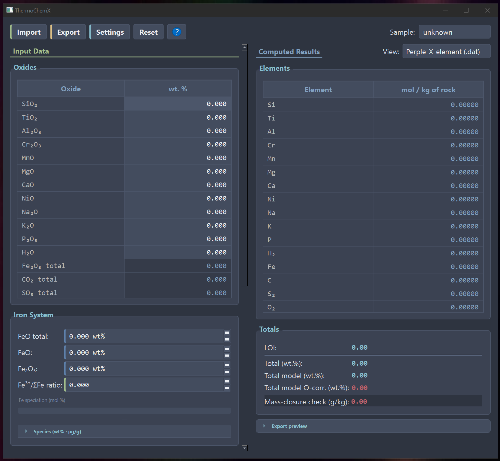
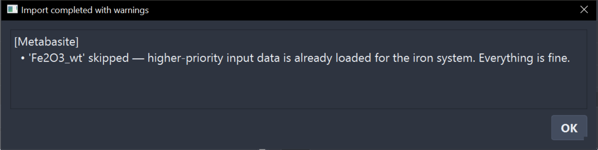
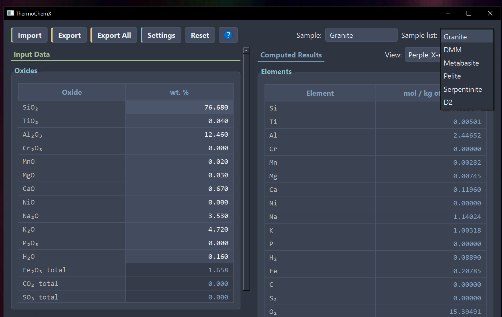
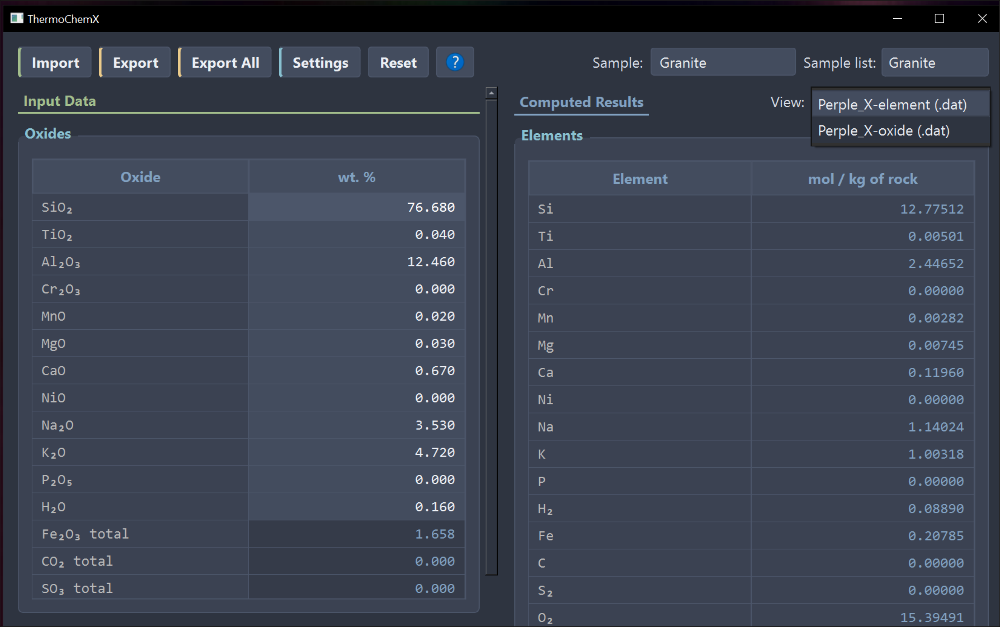
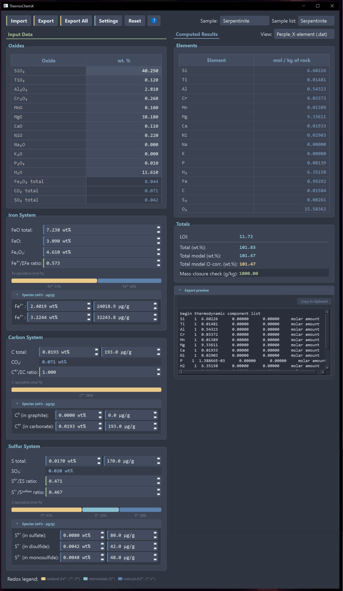
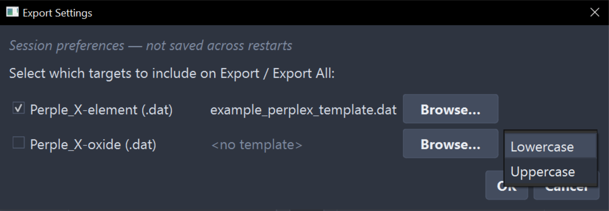

# ThermoChemX v1.0.0 - Worked Example
**From whole-rock analyses to Perple_X-ready bulk compositions**

*Software version: 1.0.0 *

---

## 1 Purpose

This walkthrough demonstrates the complete ThermoChemX pipeline on real data: preparing the input file, importing whole-rock analyses, configuring the iron, carbon, and sulfur redox systems, inspecting the computed molar composition and O₂ balance, and exporting Perple_X-ready `.dat` files in both the element and the oxide basis. The example uses six bulk compositions spanning the granite, depleted mantle, metabasite, pelite, serpentinite, and a synthetic Fe–C–S–H–O composition. Each was chosen to exercise a different supported input route, so that by the end you will have seen every way of supplying data to ThermoChemX. Working through the example takes about 15 minutes, and everything you produce can be verified against the files in `expected_output/` (Sect. 7).

## 2 The example dataset

All six compositions are contained in a single input file, `input/import_example.csv`. Each is a published analysis (or, for D2, a published synthetic composition) with full provenance:

| `sample_name` | Original ID | Lithology | What it demonstrates | Source |
|---|---|---|---|---|
| Granite | JG-2a | Granite (GSJ geochemical reference material) | Iron by **explicit speciation** (Fe₂O₃ + FeO in wt%) | Mikuni et al. (2025) |
| DMM | — | Depleted MORB mantle | Iron by **total + ratio**; carbon from **elemental µg/g + ratio** | Salters & Stracke (2004); Fe³⁺/ΣFe from O'Neill et al. (1993) |
| Metabasite | BK-95 | Metadolerite (Bakersville dike swarm) | **Deliberately conflicting iron input** (total + ratio *and* a lone explicit Fe₂O₃): demonstrates tier priority, the skip-warning, and ratio-last override | Wilcox & Poldervaart (1958) |
| Pelite | L7-1 | Lower Devonian pelite | Explicit iron speciation; **automatic LOI/H₂O handling** (LOI given, no H₂O) | Duchesne et al. (2018), from the compilation of Forshaw & Pattison (2022) |
| Serpentinite | Al98-05a | Antigorite serpentinite, Cerro del Almirez | **Full sulfur speciation in µg/g** with total-S consistency check; iron speciation with total-Fe cross-check | Garrido et al. (2005); volatiles: Alt et al. (2012); Fe redox: Debret et al. (2015) |
| D2 | synthetic | Fe–C–S–H–O model composition | Strongly reduced bulk (S⁶⁺/ΣS = 0, all reduced S as disulfide); the only composition in the set that triggers the **excess-O₂ cap** in the oxide basis | Bukała et al. (2026), demonstration section |

### Full references

- Alt, J. C., Garrido, C. J., Shanks, W. C., Turchyn, A., Padrón-Navarta, J. A., López Sánchez-Vizcaíno, V., Gómez-Pugnaire, M. T., & Marchesi, C. (2012). Recycling of water, carbon, and sulfur during subduction of serpentinites: A stable isotope study of Cerro del Almirez, Spain. *Earth and Planetary Science Letters*, 327–328, 50–60. https://doi.org/10.1016/j.epsl.2012.01.029
- Bukała, M., et al. (2026). [ThermoChemX companion paper — full citation upon publication].
- Debret, B., Bolfan-Casanova, N., Padrón-Navarta, J. A., Martin-Hernandez, F., Andreani, M., Garrido, C. J., López Sánchez-Vizcaíno, V., Gómez-Pugnaire, M. T., Muñoz, M., & Trcera, N. (2015). Redox state of iron during high-pressure serpentinite dehydration. *Contributions to Mineralogy and Petrology*, 169(4), 36. https://doi.org/10.1007/s00410-015-1130-y
- Duchesne, J.-C., Meus, P., & Boulvain, F. (2018). Geochemistry of Lower Devonian terrigenous sedimentary rocks from the Belgian Ardenne: Source proxy and paleogeographic reconstruction. *Sedimentary Geology*, 375, 157–171. https://doi.org/10.1016/j.sedgeo.2017.11.008
- Forshaw, J. B., & Pattison, D. R. M. (2022). Major-element geochemistry of pelites. *Geology*, 51(1), 39–43. https://doi.org/10.1130/G50542.1
- Garrido, C. J., López Sánchez-Vizcaíno, V., Gómez-Pugnaire, M. T., Trommsdorff, V., Alard, O., Bodinier, J.-L., & Godard, M. (2005). Enrichment of HFSE in chlorite-harzburgite produced by high-pressure dehydration of antigorite-serpentinite: Implications for subduction magmatism. *Geochemistry, Geophysics, Geosystems*, 6, Q01J15. https://doi.org/10.1029/2004GC000791
- Mikuni, K., Terashima, S., Okai, T., Kubota, R., Nakamura, A., & Ohta, A. (2025). Five new geochemical reference materials of igneous rocks: Andesite JA-2a, granite JG-2a, granodiorite JG-3a, gabbro JGb-1a, and peridotite JP-2. *Geochemical Journal*, 59(6), 271–282. https://doi.org/10.2343/geochemj.GJ25016
- O'Neill, H. S. C., Rubie, D. C., Canil, D., Geiger, C. A., Ross, C. R. II, Seifert, F., & Woodland, A. B. (1993). Ferric iron in the upper mantle and in transition zone assemblages: Implications for relative oxygen fugacities in the mantle. In E. Takahashi, R. Jeanloz, & D. Rubie (Eds.), *Evolution of the Earth and Planets*. AGU Geophysical Monograph 74. https://doi.org/10.1029/GM074p0073
- Salters, V. J. M., & Stracke, A. (2004). Composition of the depleted mantle. *Geochemistry, Geophysics, Geosystems*, 5, Q05B07. https://doi.org/10.1029/2003GC000597
- Wilcox, R. E., & Poldervaart, A. (1958). Metadolerite dike swarm in Bakersville–Roan Mountain area, North Carolina. *GSA Bulletin*, 69(11), 1323–1368. https://doi.org/10.1130/0016-7606(1958)69[1323:MDSIBM]2.0.CO;2

**A note on D2.** D2 is a synthetic bulk composition used in the companion paper (Bukała et al., 2026), where the corresponding modelling results are shown in the demonstration section. It is included here for two reasons: it carries all three redox systems simultaneously, and it is strongly reduced — the only composition in this set for which the oxide-basis export triggers the excess-O₂ cap, making it the demonstrator for why the element basis exists (Sect. 6.2).

## 3 The input file

### 3.1 Layout

Open `input/import_example.csv` in any spreadsheet program. The file follows the layout of `import_example.csv` shipped with ThermoChemX:

- **One row per variable, one column per sample.** Column A (`Description`) is free text explaining each variable and is ignored by the importer; column B (`key`) is the machine-readable identifier that the importer matches against. Sample columns follow from column C.
- **41 input keys** are available in total, covering major oxides, volatiles, and the iron, carbon, and sulfur redox systems in several unit conventions (wt% as oxide, wt% as element, µg/g). The complete key reference is in [`docs/data_dictionary.md`](data_dictionary.md).
- **You never need all 41.** The importer accepts whatever subset your data provides; empty cells simply mean "not analysed / not provided". Note in the example that Serpentinite lacks Na₂O and K₂O values, and Pelite provides LOI but no direct H₂O and both are handled without any special configuration.

### 3.2 Supplying the redox systems: two routes

For each redox system (Fe, C, S) the composition can be supplied in **one of two ways**:

1. **Total + ratio** — a total amount (as oxide or element, in wt% or µg/g) plus the molar ratio(s) that partition it between oxidation states.
2. **Explicit speciation** — the amount of each oxidation state given directly.

Both routes resolve to the same internal state, but the importer must decide what to do when a sample provides more than one. The decision logic (full tier tables in [`docs/data_dictionary.md`](data_dictionary.md)) reduces to three rules:

1. **Tiers, walked top-down.** Within each system, input keys are grouped into tiers: totals first (Tier A: e.g. `Fe2O3_total_wt`, `FeO_total_wt`), then species as oxides in wt%, then species as elements in wt%, then in µg/g. The first tier with any present key wins; keys belonging to lower tiers are **skipped, each with an explicit warning** naming the ignored key.
2. **Consistency override.** One exception precedes the tier walk: if a species tier is *complete* and its sum reproduces the Tier-A total within tolerance, the redundant total is silently dropped and the species values are used. A total supplied alongside full speciation therefore acts as a free cross-check (the Serpentinite case below).
3. **Ratios always win last.** Molar-ratio keys (`Fe3plus_Fetotal_ratio`, `C4plus_Ctotal_ratio`, …) are applied after the tier walk and **override whatever partitioning the winning tier implied**. Supply a ratio only when you mean it.

The Metabasite column exists precisely to let you watch rules 1 and 3 fire (see below).

The six example compositions were deliberately set up so that each system is demonstrated through a different route:

**Iron.**
- *Granite* provides only `Fe2O3_wt` (0.98) and `FeO_wt` (0.61) — the explicit-speciation route. ThermoChemX computes the totals, the Fe³⁺/ΣFe molar ratio, and the elemental Fe²⁺/Fe³⁺ amounts in wt% and µg/g.
- *DMM* provides only `FeO_total_wt` (8.07) and `Fe3plus_Fetotal_ratio` (0.04, after O'Neill et al., 1993) — the total + ratio route. The software computes everything else.
- *Serpentinite* provides explicit speciation (`Fe2O3_wt` 4.61, `FeO_wt` 3.09) **plus** `Fe2O3_total_wt` (8.04). The species pair is complete and its sum reproduces the total (3.09 wt% FeO corresponds to 3.43 wt% Fe₂O₃; 4.61 + 3.43 = 8.04), so the consistency override silently drops the redundant total and imports the explicit speciation — no warning, because nothing disagrees.
- *Metabasite* is **deliberately conflicting**. It supplies `FeO_total_wt` (11.5) and `Fe3plus_Fetotal_ratio` (0.24) — a valid Tier-A input — *plus* a lone `Fe2O3_wt` (4.09) with no matching `FeO_wt`. Because the species tier is incomplete, the consistency override cannot engage; the tier walk selects Tier A, and the stray `Fe2O3_wt` is **skipped with a warning naming it** (rule 1). On import, this warning surfaces in a pop-up dialog listing every sample that raised a warning or error — you will see Metabasite flagged there (Sect. 4.1, Figure 2). The ratio is then applied last (rule 3), so the imported state is FeO-total = 11.5 wt% with Fe³⁺/ΣFe = 0.24. Note that the skipped value would have implied Fe³⁺/ΣFe ≈ 0.32: the software resolves the conflict deterministically, but it cannot know which of your numbers is correct — the warning is your prompt to go back to the source data. This column exists so that you meet that warning here, rather than for the first time on your own samples.

**Carbon.**
- *DMM* provides only elemental carbon in µg/g (`C_total_ugg` = 13.73) and `C4plus_Ctotal_ratio` = 1. ThermoChemX computes CO₂-total and C-total in wt% and the C⁰/C⁴⁺ speciation in wt% and µg/g.
- *D2* provides `CO2_total_wt` (11.8112) and a ratio of 0.5 — half the carbon as carbonate, half as graphite.

**Sulfur.**
- *Serpentinite* provides the three species directly in µg/g (`S6plus_ugg` 80, `S1minus_ugg` 42, `S2minus_ugg` 48) together with `S_total_ugg` (170). Because 80 + 42 + 48 = 170, the complete species tier supersedes the total via the consistency override (rule 2). Had the sum not matched, the total would have won the tier walk and the species values would have been skipped with warnings — the same mechanism the Metabasite iron column demonstrates.
- *D2* provides `SO3_total_wt` (21.4871) with `S6plus_Stotal_ratio` = 0 and `S1minus_Ssulfides_ratio` = 1: all sulfur reduced, and all of it bound as disulfide (pyrite-type FeS₂).

### 3.3 Defaults when no ratio is provided

> **Note.** If a total is supplied without the corresponding molar ratio(s), ThermoChemX applies the following defaults:
>
> | Ratio | Default | Meaning |
> |---|---|---|
> | Fe³⁺/ΣFe | 0 | all iron ferrous |
> | C⁴⁺/ΣC | 1 | all carbon as carbonate-bound CO₂ |
> | S⁶⁺/ΣS | 0 | all sulfur reduced (no sulfate) |
> | S¹⁻/ΣS(reduced) | 0 | all reduced sulfur as monosulfide S²⁻ (pyrrhotite-type); no disulfide (pyrite) |
>
> Defaults are a convenience, not a recommendation: whenever a measured or literature-based ratio exists for your samples, provide it explicitly, and record its source (see Sect. 3.4).

### 3.4 Adapting the file to your own data

To use the template for your own samples, keep columns A and B, delete the sample columns (C onward), and insert your data: one column per sample, values placed against the matching keys, cells left empty where no data exist. Two practical recommendations:

- **Carry provenance inside the file.** The free-text `Description` column (and, if convenient, unused header cells) can hold source citations and comments. The importer ignores them, but anyone who later copies your CSV inherits the documentation. The example file uses this for exactly that purpose: the header notes "P2O5 excluded" (DMM) and "TiO2 and P2O5 excluded" (Serpentinite) document components that **are reported in the source publications but were deliberately removed here**, to vary the completeness of the inputs across the example set. Be aware, therefore, that these two shipped compositions deviate slightly from their published originals.
- **Save as UTF-8 CSV** so that special characters in the description texts survive the round trip between spreadsheet programs.

## 4 Importing the data

### 4.1 Launch and import

1. Launch ThermoChemX (installation: see the main [`README`](../README.md); the one-click launcher and `python app.py` open the same main window, **Figure 1**).

   

2. A composition can be typed directly into the **Input data** table — but for this walkthrough click **Import**. A file dialog opens (by default in the ThermoChemX directory); navigate to this example's `input/` folder and select `import_example.csv`.

3. The import finishes with a pop-up titled **"Import completed with warnings"** (**Figure 2**), listing every sample that raised a warning or error. You should see **exactly one warning — Metabasite — and zero errors**: the skip-warning for the stray `Fe2O3_wt` explained in Sect. 3.2. Anything else in this list means something went wrong on your side; check the troubleshooting section of the main README before continuing.

   

4. Because a multi-sample file was imported, an **Export all** button has appeared alongside **Export** — it will matter in Sect. 6.

### 4.2 Navigating samples and views

The **Sample list** on the right-hand side selects which sample is displayed (**Figure 3**). Below it, the **View** selector switches the **Computed Results** table between the **element** and the **oxide** representation (**Figure 4**) — the same two conventions as the export targets, so you can inspect exactly what each `.dat` file will contain before exporting anything.

## 5 Exploring the redox systems

Select **Serpentinite** and look at the **Iron**, **Carbon**, and **Sulfur** system panels (**Figure 5**). Each panel displays the oxidation states of its redox-variable element; the bar at the bottom of each panel visualises how the element is partitioned between species — for Serpentinite, exactly the values discussed in Sect. 3.2.

These panels are live. Change any parameter — a species abundance, or especially a molar ratio — and two things update simultaneously: the partitioning bar, and the mol/kg amounts in the **Computed Results** table and the **Export preview**. Watch the **O₂ component** in particular: it carries the redox budget, so shifting Fe, C, or S between oxidation states visibly changes the bulk composition that Perple_X will receive. This is the central point of ThermoChemX made tangible — oxidation state is not cosmetic metadata; it is part of the bulk composition.

When you are done experimenting, click **Reset**: all values return to the imported state. Nothing you change in these panels affects the CSV on disk.

## 6 Exporting Perple_X input files

### 6.1 Export settings

Click **Settings** to open the export-settings dialog (**Figure 6**). Two things are configured here:

- The **export target(s)**: `Perple_X element (.dat)`, `Perple_X oxide (.dat) [lowercase]`, or `Perple_X oxide (.dat) [uppercase]`. Lower- versus uppercase follows the component-naming convention of the thermodynamic database you intend to use — see "Compatible thermodynamic databases" in the main README.
- Optionally, **per target, a Perple_X build-file template** via **Browse**: the exported composition is then injected into the template, producing a complete, ready-to-run build file rather than a bare composition block.

For this walkthrough, select both **Perple_X element** and **Perple_X oxide [lowercase]**, leave the templates empty for now, and confirm.

### 6.2 Export all samples

**Export** writes only the currently displayed sample; **Export all** writes every imported sample in every selected target. Click **Export all**. A confirmation dialog lists the full paths of the **12 files written** — six element-basis and six oxide-basis. The naming convention is:

- `{sample}_elem.dat` — element basis
- `{sample}_ox_low.dat` — oxide basis, lowercase components

One event during this export is expected and deliberate: for **D2**, the oxide-basis export triggers the **excess-O₂ cap**. D2 is strongly reduced, and representing it in the oxide basis would require a negative excess-O₂ component, which Perple_X does not accept. ThermoChemX caps the component at zero and reports it in the **Warnings** block of the export confirmation dialog: *"Excess O₂ is negative (−0.85439 mol/kg) for this composition and has been capped at 0 for the oxide basis, which cannot represent this degree of reduction … export this sample in the element basis."* The embedded snapshot stores both the capped export value and the true one (`der.oxide_o2_value_molkg −0.85439`), and re-importing `D2_ox_low.dat` raises the warning again, because the negative excess O₂ is re-derived on import. This is the practical demonstration of the rule stated in the main README: strongly reduced compositions belong in the **element basis**, which preserves the full reduction state — and the element-basis D2 file is exactly what we refine next.

### 6.3 Template export: a ready-to-run build file

1. Open **Settings** again and, for the **element** target, click **Browse** and select `input/example_perplex_template.dat` — the Perple_X build-file template pinned inside this example.
2. Select **D2** in the sample list and click **Export** (single sample). One click now writes **three files**: the two snapshot exports for the selected targets (`D2_elem.dat`, `D2_ox_low.dat`) plus the template-injected `D2_2d.dat`.
3. `D2_2d.dat` is a complete Perple_X build file: the D2 composition injected into the template, ready to be run with `vertex` without further editing. It is, in fact, the build file used for the demonstration models of the companion paper (Bukała et al., 2026).

## 7 Verification

Your output directory should now contain **13 files**. Compare them against `expected_output/`:

| Files | Count |
|---|---|
| `{sample}_elem.dat` — Granite, DMM, Metabasite, Pelite, Serpentinite, D2 | 6 |
| `{sample}_ox_low.dat` — the same six samples | 6 |
| `D2_2d.dat` — template-injected build file | 1 |

All numerical values must match those in `expected_output/` to **five decimal places**. Three checkpoints recap what this run was designed to demonstrate:

1. **Import** produced exactly one warning (Metabasite) and zero errors (Sect. 4.1).
2. **Metabasite's resolution**: open `Metabasite_elem.dat` — the iron partitioning corresponds to Fe³⁺/ΣFe = 0.24, i.e. the Tier-A ratio won and the stray oxide value was discarded, exactly as predicted in Sect. 3.2.
3. **D2's two faces**: `D2_ox_low.dat` carries the capped (zero) excess-O₂ component, with the true value (−0.85439 mol/kg) preserved in its snapshot, while `D2_elem.dat` (and `D2_2d.dat`) retain the full reduction state.

If any file differs, first confirm that your software version matches the one stated at the top of this document, then consult the troubleshooting section of the main README.

---

The full user manual (PDF) is available from **Help → About** in the application, or at [`manual.pdf`](../src/thermochemx/assets/manual.pdf) (also available via **Help → About** inside the application).

